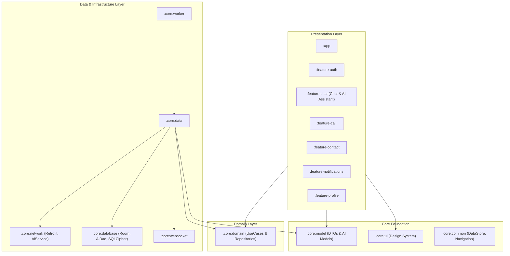

# AbsApp 📱💬📞🤖

[](https://www.android.com)
[](https://kotlinlang.org)
[](https://developer.android.com/jetpack/compose)
[](https://dagger.dev/hilt)
[](https://developer.android.com)
[](LICENSE)

**AbsApp** is a modern, Offline-First Android communication application built with Kotlin and Jetpack Compose. It integrates real-time P2P messaging, audio/video calling, contact management, and an **LLM-powered AI Assistant** backed by a robust multi-module Clean Architecture.

---

## 🚀 Overview

AbsApp is engineered for high performance, security, and scalability. Beyond core communication features—such as real-time 1-on-1 and group chats, high-definition audio/video calls via Agora RTC, and encrypted storage with SQLCipher—AbsApp features an **intelligent LLM AI Assistant** capable of text and multimodal image/media interactions, conversation history management, and offline message persistence.

---

## ✨ Features

### 🤖 LLM & Multimodal AI Assistant
- **AI Conversational Partner**: Interactive AI assistant for real-time natural language query answering and assistance.
- **Multimodal Support**: Send text prompts combined with image or media attachments (`/api/ai/chat/multimodal`).
- **Conversation Management**: Create new chats, pin key conversations, browse chat history, and delete conversations via a drawer interface.
- **Offline Caching**: Room database integration (`AiDao`, `AiMessageEntity`) ensures chat history is cached locally and accessible offline.

### 💬 Real-Time Chat
- **1-on-1 & Group Messaging**: Create chats, group rooms, and exchange messages instantly using WebSockets.
- **Rich Media Sharing**: Audio message recording and playback, high-res image sharing with interactive full-screen viewer, and video playback.
- **Interactive Chat Controls**: Swipeable chat items, reply quote preview chips, delivery status indicators, and custom top bars.

### 📞 Audio & Video Calls
- **Agora RTC Integration**: High-definition peer-to-peer audio and video calling.
- **Call Controls**: Complete calling UI with muted state toggles, camera flipping, speaker toggles, and pulsing indicators.
- **Overlays & Notifications**: Dedicated incoming call overlays and full-screen notification triggers.

### 🔐 Authentication & Profile
- **Onboarding & Auth Flows**: Phone/email authentication, OTP verification, and JWT session handling.
- **Secure Token Refresh**: Automated token refresh mechanism via custom OkHttp Interceptors and Authenticators.
- **Profile Management**: Profile picture upload (via Cloudinary) and user detail updates.

### 📇 Contacts & Sync
- **Device Contact Sync**: Synchronize and map device contacts seamlessly with background WorkManager tasks.
- **Encrypted Local Storage**: SQLite Room database encrypted with SQLCipher security (`net.zetetic:android-database-sqlcipher`).

### 🔔 Notifications & Background Tasks
- **Firebase Cloud Messaging (FCM)**: Push notifications for real-time messages and incoming call events.
- **WorkManager**: Background sync workers for contact synchronization and media upload queueing.

---

## 🛠️ Tech Stack

- **Language**: [Kotlin 2.1.0](https://kotlinlang.org)
- **UI Framework**: [Jetpack Compose (Material 3)](https://developer.android.com/jetpack/compose), Navigation Compose, Accompanist, Coil, Media3 (ExoPlayer)
- **Architecture**: Multi-module Clean Architecture (Domain, Data, Presentation) following MVVM + MVI pattern.
- **Dependency Injection**: [Dagger Hilt](https://dagger.dev/hilt) (`2.54`), Hilt Navigation Compose, Hilt Work.
- **AI & LLM Services**: REST API endpoints for LLM chat (`AiService`), Multipart form-data for multimodal file uploads.
- **Networking & Real-Time**: Retrofit 2, OkHttp 4, WebSockets (`WebSocketManager`), kotlinx.serialization.
- **Database & Security**: Room Database, SQLCipher Encryption, DataStore Preferences.
- **Real-Time & Media SDKs**: Agora RTC Engine (`4.5.1`), Cloudinary Media SDK.
- **Background Processing**: WorkManager (`2.9.0`), Hilt Worker integration.
- **Services**: Firebase Cloud Messaging (FCM), Firebase Performance Monitoring.
- **Build System**: Gradle Version Catalogs (`libs.versions.toml`), AGP `8.13.2`.

---

## 🏛️ Architecture

AbsApp follows a multi-module Clean Architecture approach, dividing components into presentation feature modules, core domain logic, database, network, and AI services.



### Module Breakdown
- **`:app`**: Application entry point, navigation host (`AppNavHost`), overlay handlers.
- **`:feature-chat`**: Real-time chat UI, media handlers, and the **AI Assistant interface (`AiConversation`)**.
- **`:feature-auth`**, **`:feature-call`**, **`:feature-contact`**, **`:feature-notifications`**, **`:feature-profile`**, **`:feature-settings`**: Self-contained UI feature modules.
- **`:core:domain`**: Abstractions for repositories (e.g. `AiRepository`, `ChatRepository`, `CallRepository`) and domain models.
- **`:core:data`**: Implementations of repositories, data mapping (`AiMapper`), and network/local orchestration.
- **`:core:database`**: Room Database schema including `AiDao`, `AiMessageEntity`, `AiAttachmentsEntity`, and SQLCipher encryption.
- **`:core:network`**: `AiService` (LLM chat & multimodal endpoints), `AuthService`, `ChatService`, and OkHttp interceptors.
- **`:core:websocket`**: Real-time WebSocket manager for instant messaging and presence.
- **`:core:worker`**: WorkManager background workers for media uploads and contact sync.
- **`:core:model`**: Data transfer objects (DTOs), API models (`ChatRequestDto`, `AiMessageUiModel`).
- **`:core:ui`**: Reusable Material 3 Compose components, themes, input fields, and dialogs.
- **`:core:common`**: DataStore preferences, token utilities, navigation destinations, and validator helpers.

---

## 🏁 Getting Started

### Prerequisites
- **Android Studio**: Ladybug / Narwhal or newer.
- **JDK**: Version 11 or higher.
- **SDK**: Compile SDK 36, Min SDK 24.

### Build & Run
1. Clone the repository:
   ```bash
   git clone https://github.com/your-username/AbsApp.git
   ```
2. Open the project in Android Studio.
3. Sync Gradle and build dependencies.
4. Configure required service files and keys:
   - `google-services.json` for FCM.
   - Cloudinary configuration in `AbsApplication.kt`.
   - Agora App ID for Audio/Video calling.
   - LLM Server Base URL in network configuration.
5. Build and run on an Android emulator or physical device.

---

## 📄 License

This project is licensed under the MIT License - see the [LICENSE](LICENSE) file for details.
